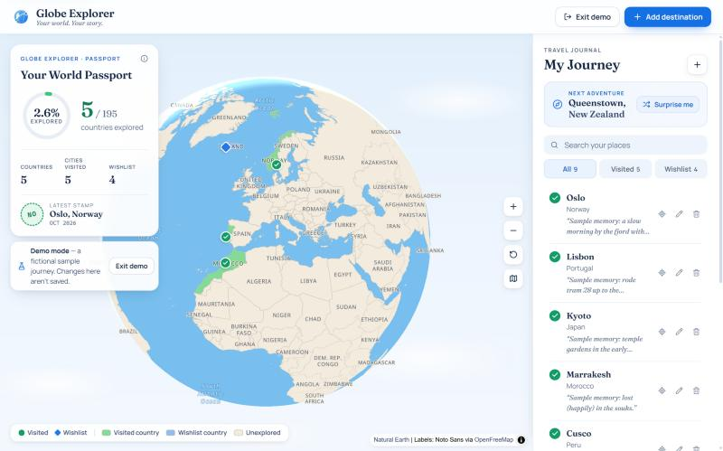
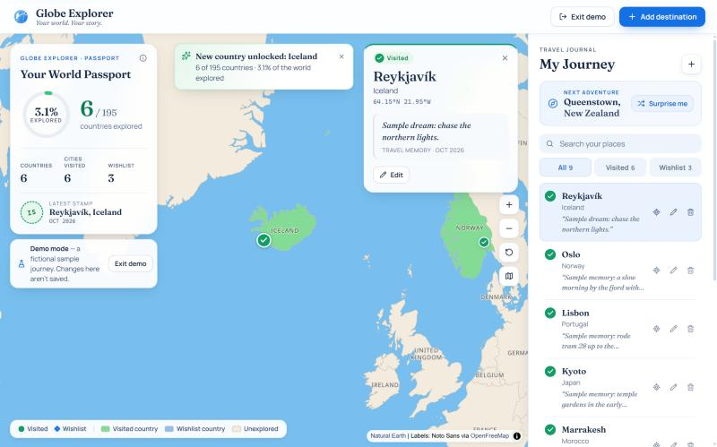
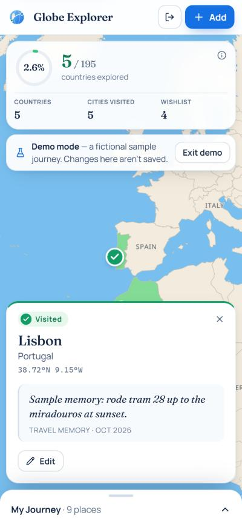
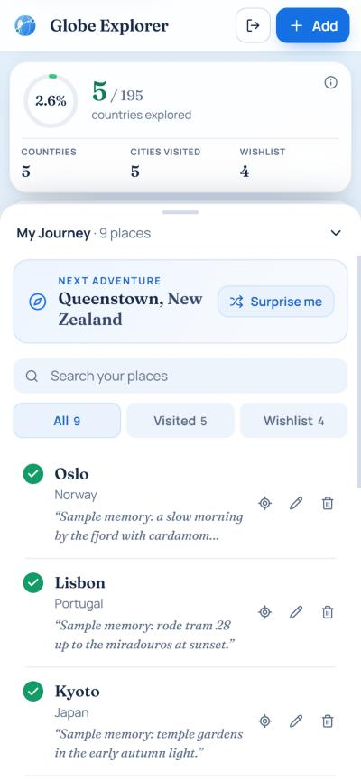

# Globe Explorer

**Your world. Your story.**

Globe Explorer is an interactive travel globe. Pin the places you have been and the places you dream of, watch the countries light up on a bright, atlas-style 3D Earth, and follow your progress in a digital World Passport.

It is a frontend-only prototype built for *Mandatory Assignment 3: Vibe Coding — Build Your Own App*. There is no backend, no login and no API key — your journey is stored in your own browser.



| New country unlocked | Mobile: destination details | Mobile: journey sheet |
| --- | --- | --- |
|  |  |  |

## Features

**1. Interactive travel globe**
- A rotatable, zoomable 3D Earth using MapLibre GL's native globe projection, with a soft atmosphere and a gentle idle spin.
- A minimal white atlas: pale grey-blue ocean, white land, thin borders and muted uppercase country labels — no terrain, roads or city clutter.
- Countries are coloured by travel status using real country polygons (Natural Earth), not circles:
  - **green** — at least one *visited* destination there;
  - **amber/orange** — wishlist destinations only;
  - **white** — nothing saved yet.
  A visit always wins: visit Madrid and keep Barcelona on your wishlist, and Spain stays green. Colours are derived from your saved destinations and update instantly on add, edit, delete, demo mode, reload and cross-tab changes.
- Every destination is a marker: green **circles with a tick** for visited, orange **diamonds** for the wishlist (shape *and* colour, so status never relies on colour alone).
- Click a marker or a list row to fly there and open a journal-style detail card.
- Flights take the shortest route — including across the international date line (e.g. Suva → Apia).
- Map controls: zoom, return to world overview, and switch between globe and flat map.
- Markers on the far side of the globe are hidden and removed from the tab order.

**2. My Journey — destination management**
- Search 132 curated cities (case- and accent-insensitive; matches city or country, e.g. "zurich", "norway"). Same-named cities are distinguished by country (Córdoba, Spain / Córdoba, Argentina).
- Choose *Visited* or *Want to visit*, and add an optional note (max 280 characters).
- Can't find a place? **Drop a pin on the globe** — the country is detected locally from the bundled polygons (no reverse-geocoding service) and you give the place a name.
- Edit status, note or place; delete with a confirmation dialog.
- Duplicates are prevented by a stable location id; the form offers "Edit it instead".
- Sidebar with search, *All / Visited / Wishlist* filter (also filters map markers), and quick locate / edit / delete actions. On phones and portrait tablets it becomes a bottom sheet.
- A first-run empty state and an optional, clearly labelled **Try demo** mode.

**3. World Passport — progress**
- Countries visited, cities visited, wishlist count and **% of the world explored**, all calculated from your data.
- Animated progress ring, a "latest stamp" for your most recent visited place, and an info popover explaining the calculation.
- *New country unlocked* / *Another place added to your story* feedback when you mark a place as visited.

**Extras:** Journey Spotlight ("Next adventure" + **Surprise me**, which flies to a random wishlist destination), self-hosted fonts, reduced-motion support, keyboard-friendly dialogs and visible focus states.

## The 195-country convention

> **World explored = (unique visited countries ÷ 195) × 100**

195 = the **193 UN member states + 2 UN observer states** (Holy See and Palestine). This is the share of *countries* visited, **not** the share of Earth's land area.

Map datasets contain more shapes than that (territories, dependencies, disputed areas), so all country codes pass through a normalization layer in [`src/domain/countries.ts`](src/domain/countries.ts):

- A code in the 195 list counts as itself (e.g. `NO` → Norway).
- A territory counts towards its sovereign state (e.g. Hong Kong `HK` → China, Puerto Rico `PR` → United States). Its own polygon is still the one highlighted.
- Anything else (e.g. Antarctica, Kosovo, Taiwan, Western Sahara) is shown on the map but **does not** raise the percentage; the passport info popover mentions it.

Countries are deduplicated by ISO 3166-1 alpha-2 code, so visiting Oslo and Bergen counts Norway once. A country counts as visited only if at least one of its destinations has the status *visited*; wishlist entries never count.

## Technology

| Area | Choice |
| --- | --- |
| UI | React 19, TypeScript 6, Vite 8 |
| Map | MapLibre GL JS 6 (globe projection) |
| Icons | Lucide React |
| Fonts | Fraunces + Manrope, self-hosted via Fontsource (no Google Fonts request) |
| Styling | Plain CSS with custom properties (no CSS framework) |
| State | React state + custom hooks (`useDestinations`, `useToasts`) |
| Storage | Browser `localStorage` (versioned key) |
| Quality | ESLint, TypeScript, Vitest |

### Project structure

```
src/
  domain/        Pure logic — types, countries (195 normalization), destinations
                 (validation, dedupe, CRUD), stats, countryStatus (map colours),
                 storage, demo data (+ tests)
  data/          Curated cities (generated from Natural Earth) and search
  hooks/         useDestinations (collection + persistence), useToasts
  components/    Header, DestinationSidebar, DestinationForm, DestinationDetails,
                 WorldPassport, JourneySpotlight, EmptyState, Modal, Toasts, Logo
  components/globe/
                 TravelGlobe (MapLibre lifecycle, markers, highlighting),
                 globeStyle (the map style + colour expressions, tested),
                 maplibreSetup (worker URL)
  styles/        base.css (tokens, buttons, inputs), app.css (layout, components)
scripts/         build-geodata.mjs, copy-maplibre-worker.mjs
public/data/     countries.geojson (country polygons), country-labels.geojson (label points)
```

Business logic lives in `src/domain` and has no React or DOM dependency, which is what the unit tests cover.

## Getting started

Requirements: Node.js 22.12+ or 24 (developed on Node 24.19) and npm.

```bash
git clone https://github.com/Nicolaia2d/Globe-Explorer.git
cd Globe-Explorer
npm install
npm run dev          # http://localhost:5173
```

Other scripts:

```bash
npm run build        # type-check and build to dist/
npm run preview      # serve the production build locally
npm run test         # Vitest unit tests
npm run lint         # ESLint
npm run typecheck    # TypeScript project build
npm run check        # all of the above, in order
npm run data:build   # regenerate countries.geojson, country-labels.geojson + curated cities from Natural Earth
```

`predev`/`prebuild` automatically copy MapLibre's web worker to `public/vendor/` (see *Known limitations*).

## How data is stored

- Destinations are saved in your browser's `localStorage` under the key `globe-explorer:v1` as `{ "version": 1, "destinations": [...] }`.
- Nothing is sent to a server. Data **does not sync** between browsers or devices, and clearing site data deletes it.
- Several tabs of the same browser stay in sync: a tab adopts changes saved by another tab (via the `storage` event) instead of overwriting them, and nothing is written until you actually change something.
- On load, every record is validated: malformed JSON or invalid records never crash the app. Unreadable data is copied to `globe-explorer:v1:unreadable-backup` before anything is overwritten, and a banner explains what happened.
- **Demo mode** uses a separate, in-memory sample collection. It is never written to storage and is discarded when you exit — it cannot mix with your own journey. All demo notes start with "Sample".
- Notes are rendered as plain text by React (no HTML injection).

## Geographic data and attribution

- **Country polygons and labels:** [Natural Earth](https://www.naturalearthdata.com/) 1:50m Admin 0 – Countries (public domain), trimmed to `{ iso, name }` and bundled in `public/data/countries.geojson`. Natural Earth's hand-placed label points and label ranks are bundled in `public/data/country-labels.geojson`. The whole map — ocean, land, borders, highlighting and labels — is drawn from this local data; there is no external tile or geographic API.
- **City coordinates:** taken from Natural Earth 1:10m Populated Places by [`scripts/build-geodata.mjs`](scripts/build-geodata.mjs). The build fails if a curated city is not found — no coordinates were typed by hand.
- **Label font:** Noto Sans glyphs (SIL Open Font License) served by [OpenFreeMap](https://openfreemap.org/)'s font endpoint — the only remote map request. Free, no API key, no registration. Attribution is shown in the map's attribution control (collapsed behind the ⓘ button on small screens).
- **Map engine:** [MapLibre GL JS](https://maplibre.org/) (BSD-3-Clause).

## Known limitations

- **Label glyphs:** country names need font glyphs from OpenFreeMap, a free community service with no SLA. If it is unreachable the globe, colours and markers still work — only the map labels are missing. A production app should self-host the glyphs.
- **Zoom depth:** the map stops at zoom 7, where the 1:50m country shapes still look clean. It is a travel overview, not a street map.
- **Boundaries:** Natural Earth's default "de facto" boundaries are used as-is (e.g. its Morocco polygon includes the Moroccan-administered part of Western Sahara). They do not represent a political position.
- **Small countries:** micro-states are present at 1:50m but tiny on the globe; the marker is the main visual for them.
- **Local storage only:** no accounts, sync or backup beyond your browser.
- **WebGL required:** without WebGL the globe shows an explanatory message; the journey list, forms and passport still work.
- **MapLibre worker:** MapLibre 6 locates its web worker relative to its own module, which breaks under Vite's dev server. `scripts/copy-maplibre-worker.mjs` copies the worker into `public/vendor/` so it is served untouched in dev and production.
- **Bundle size:** MapLibre is ~1 MB minified (~380 kB gzipped total bundle); the bundled country file is ~1.5 MB uncompressed (served compressed by most static hosts).
- **Curated list:** 132 cities. Anything else can be added with a custom pin.

## Deployment

The production build is fully static (`dist/`) and uses relative asset paths (`base: './'`), so it works at a domain root or a sub-path.

- **GitHub Pages:** enable *Settings → Pages → Source: GitHub Actions*, then run the **Deploy to GitHub Pages** workflow manually (Actions tab). It is `workflow_dispatch`-only, so nothing is published until someone chooses to.
- **Vercel / Netlify:** import the repository; framework preset *Vite*, build command `npm run build`, output directory `dist`.

Pull requests and pushes run the **CI** workflow (type-check, lint, tests, build).

## AI-assisted development

See [`docs/AI_DEVELOPMENT.md`](docs/AI_DEVELOPMENT.md) for how generative AI was used, key decisions, what was tested, and the problems found and fixed along the way.

## Travel history & private journal (additional student features)

The updated version adds **Year visited** to the Add/Edit destination form. The year
is optional for visits (1900 through the current year). A **Timeline** button in the
header opens a chronological view of all visited destinations, sorted newest year
first. Visits without dates are grouped separately. Older saved journeys work
without changes: their travel year is simply left blank until edited.

To add photographs, select a visited destination on the globe or journey list and
choose **Travel journal**. The journal shows the extended travel note and accepts
up to 6 JPEG, PNG or WebP images (8 MB per file). Existing notes are preserved.

**Storage/privacy:** Destination details and travel years are stored in the
browser's localStorage under the existing `globe-explorer:v1` key. Images are
stored in a separate IndexedDB database, `globe-explorer-journal`, because images
are too large for localStorage. No image or note is uploaded, shared or backed up.
Clearing browser/site data or switching browsers/devices loses the local data.
The existing demo mode is temporary and disables photo editing. Removing a
personal destination also removes its saved pictures.

Please test on the same browser and origin where you already have your saved
trips; localhost running on a different port is a different origin and will have
separate storage. Run `npm run check` after `npm install` to verify typechecking,
formatting rules, unit tests and production build.
